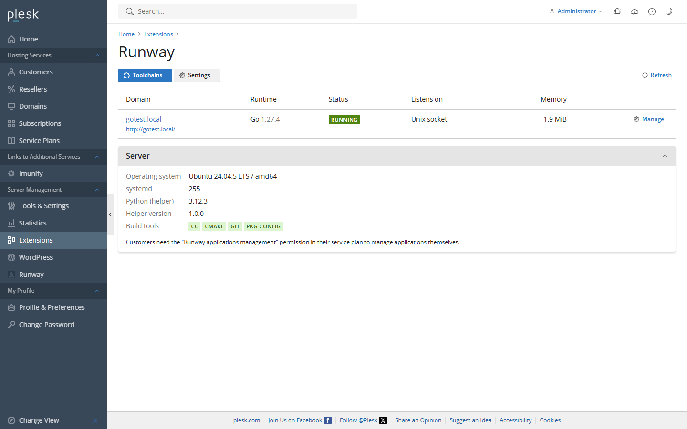
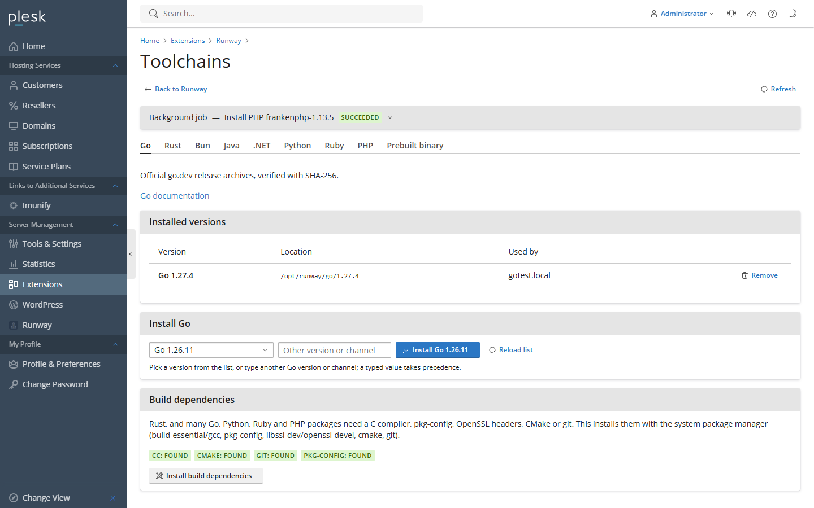
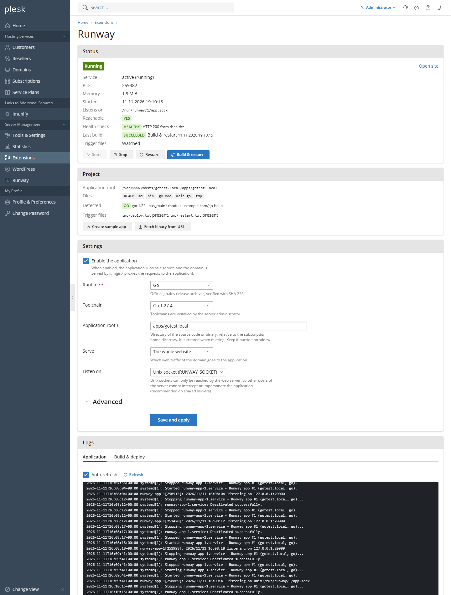

# Runway for Plesk

[](https://github.com/Taiizor/plesk-ext-runway/actions/workflows/ci.yml)
[](https://github.com/Taiizor/plesk-ext-runway/releases)
[](LICENSE)

Runway is a Plesk Obsidian extension that runs compiled and long-running applications per domain
**without Docker**: Go, Rust, Bun, Java, .NET, Python, Ruby, PHP or any prebuilt Linux binary.

- The administrator installs toolchains from the panel (official sources, checksums verified).
- Per domain, the administrator or a permitted customer picks a runtime and version, an
  application directory, build and start commands and environment variables.
- The application is built **as the subscription's system user** and runs as a hardened
  **systemd service** on `127.0.0.1:<port>` or on a private Unix socket; nginx proxies the domain
  (or one path of it) to the application, including WebSockets.
- Deployments start from the panel, from the command line, or from Git by touching
  `tmp/deploy.txt` (build + restart) or `tmp/restart.txt` (restart) in the application directory.

Node.js is deliberately not a Runway runtime: Plesk ships its own Node.js support.

## Contents

[Screenshots](#screenshots) · [Features](#features) · [Requirements](#requirements) ·
[Installation](#installation) · [Quick start](#quick-start) · [Runtimes](#runtimes) ·
[Listen modes](#listen-modes) · [Deploying with Git](#deploying-with-git) ·
[Command line](#command-line) · [Configuration reference](#configuration-reference) ·
[How it works](#how-it-works) · [Uninstalling](#uninstalling) · [Development](#development) ·
[License](#license)

## Screenshots





More in [docs/screenshots](docs/screenshots) (dark theme, customer view, drawers); how they are
made is described in [docs/RELEASING.md](docs/RELEASING.md#screenshots).

## Features

**Administrators**

- Install, update and remove toolchain versions per runtime; release lists are cached for 6 hours
  and the install runs as a background job with a live log.
- One-click installation of build dependencies (C compiler, `pkg-config`, OpenSSL headers and
  related packages) for runtimes that compile native code.
- Server-wide settings: port range, build timeout, default resource limits for applications and
  builds, maximum number of applications per subscription.
- Per-application memory, CPU and task limits that customers cannot change.
- An overview of every application on the server with its state.

**Domains** (administrators, and customers with the permission)

- Runtime, toolchain version, application directory, build and start commands with
  project-aware defaults (for example the Cargo package name or the Maven jar).
- Environment variables, stored root-only on the server and never passed on a command line.
- Listen on a TCP port, on a Unix socket, or run a background worker without a proxy.
- Proxy the whole domain or only a path prefix (for example `/api`), let the web server serve
  static folders, and check a health path.
- Start, stop, restart, build and redeploy; live status (state, PID, memory, restarts,
  listener check), application journal and build log. **Stop persists**: a stopped application
  stays stopped across reboots, deployments and trigger files until it is started again.
- **Create sample app** writes a minimal application for the chosen runtime; prebuilt binaries
  or archives can be fetched from an HTTPS URL (optional SHA-256 check).
- Trigger files for Git and CI deployments.

## Requirements

- Plesk Obsidian **18.0.55** or newer on Linux with **systemd**: Ubuntu 22.04/24.04, Debian 12,
  AlmaLinux/RHEL 9. Developed and tested on Plesk 18.0.82 / Ubuntu 24.04.
- `python3` 3.8+ (present on every Plesk server: `plesk-core` depends on it) and `/bin/bash`.
- nginx (the Plesk default). Apache-only servers work through `mod_proxy`/`mod_proxy_http`;
  WebSockets through Apache alone need Apache 2.4.47 or newer (`ProxyPass ... upgrade=websocket`,
  emitted only for those versions).
- systemd 249 or newer for the per-port bind restriction (`SocketBindAllow=`); older versions
  work without it.
- Outbound HTTPS from the server to the toolchain sources (go.dev, static.rust-lang.org,
  github.com, api.adoptium.net, builds.dotnet.microsoft.com, ...) and, during builds, to the
  package registries your applications use.
- **SELinux** (AlmaLinux/RHEL in enforcing mode; not tested): nginx/Apache (`httpd_t`) may be
  denied the connection to the applications. TCP mode then needs
  `setsebool -P httpd_can_network_connect on`; Unix socket mode needs a policy that lets
  `httpd_t` connect to the sockets in `/run/runway` (for example a local module built with
  `audit2allow` from the denials in `ausearch -m AVC -c nginx`). The overview's server facts show
  the SELinux mode and warn when it is enforcing.

## Installation

Download `runway-<version>-<release>.zip` from the
[releases](https://github.com/Taiizor/plesk-ext-runway/releases) (or [build it](#development)).

**Command line** (as root on the Plesk server):

```sh
plesk bin extension --install /root/runway-1.0.0-1.zip
# later versions: install or upgrade in one step
plesk bin extension --upgrade /root/runway-1.0.0-1.zip
```

**Panel**: Plesk only offers *Upload Extension* when it is enabled in
`/usr/local/psa/admin/conf/panel.ini` (create the file from `panel.ini.sample` if it does not
exist):

```ini
[ext-catalog]
extensionUpload = true
```

Then use *Extensions > My Extensions > Upload Extension*.

After the installation **Runway** appears in the administrator's navigation and in every
domain's *Dev Tools* (*Websites & Domains*). Customers see it when their service plan or
subscription has the **Runway applications management** permission
(*Service Plans > Permissions*).

## Quick start

1. *Runway > Toolchains*: install a version of the runtime (for example Go 1.27). Runtimes that
   compile native code (Rust, Ruby gems with extensions, Python packages without wheels) also
   need **Install build dependencies** once.
2. Upload the application into the subscription. The default application directory is
   `apps/<domain>` (outside `httpdocs`, so the sources are never served).
3. Open the domain's **Runway** page, choose runtime and version, check the build and start
   commands (Runway suggests them from the project files), enable the application and save.
   Runway builds it, starts the service and points the domain at it.

No application yet? **Create sample app** on the domain page, or upload one of the
[examples](examples).

## Runtimes

| Runtime | Toolchain | Detected from | Default build | Default start | Example |
|---|---|---|---|---|---|
| Go | managed: go.dev archives (SHA-256) | `go.mod` | `go build -o bin/app .` | `./bin/app` | [go-hello](examples/go-hello) |
| Rust | managed: rustup (`stable`, `beta`, `nightly`, `1.x.y`) | `Cargo.toml` | `cargo build --release` | `./target/release/<package>` | [rust-hello](examples/rust-hello) |
| Bun | managed: GitHub releases (SHA-256), `latest` channel | `package.json`, `bun.lock` | `bun install` (`--frozen-lockfile` with a lock file) | `bun run start` | [bun-hello](examples/bun-hello) |
| Java | managed: Eclipse Temurin JDK (Adoptium API, SHA-256) | `pom.xml`, `build.gradle(.kts)`, `*.jar`, a top-level `*.java` with `static void main` | Maven/Gradle wrapper, or `javac -d build <File>.java` | `java -jar <detected jar>` or `java -cp build <Class>` | [java-hello](examples/java-hello) |
| .NET | managed: .NET SDK (Microsoft release metadata, SHA-512) | `*.csproj`, `*.sln` | `dotnet publish -c Release -o publish` | `dotnet publish/<assembly>.dll` | [dotnet-hello](examples/dotnet-hello) |
| Python | managed: CPython through `uv` | `pyproject.toml`, `requirements.txt` | `uv venv .venv && uv pip install -r requirements.txt` (`uv sync --frozen` with `uv.lock`) | `.venv/bin/uvicorn`/`gunicorn ...` or `.venv/bin/python app.py` | [python-hello](examples/python-hello), [python-fastapi](examples/python-fastapi) |
| Ruby | detected: Plesk Ruby extension, system Ruby | `Gemfile`, `config.ru` | `bundle install` | `bundle exec puma ...` (`-C config/puma.rb` when present) | [ruby-hello](examples/ruby-hello) |
| PHP | detected: Plesk PHP handlers; managed: FrankenPHP | `composer.json`, `public/index.php`, Laravel Octane | `composer install --no-dev --optimize-autoloader` | `frankenphp php-server ...`, `php artisan octane:frankenphp --caddyfile=.runway/Caddyfile ...` or `php -S ...` | [php-hello](examples/php-hello) |
| Binary | none | executables in the app directory | none | `./app` | |

Notes:

- Toolchains live in `/opt/runway/<runtime>/` (root-owned, read-only for users). Caches
  (Go modules, Cargo registry, Bun, Maven/Gradle, NuGet, uv/pip, gems, Composer) live in
  `~/.runway/` inside the subscription, so they count against its disk quota and the customer
  can delete them.
- **Ruby** has no official prebuilt binaries: install the Plesk Ruby extension (or the
  distribution's `ruby`) and Runway detects it. Debian and Ubuntu ship Bundler of the system Ruby
  only as `bundle3.x`: Runway puts a `bundle` wrapper on the application's `PATH` (and, when no
  Bundler exists at all, the default build installs it into `~/.runway/gems` first). `GEM_HOME`
  is `~/.runway/gems`; the interpreter's bundled gems stay available.
- **PHP**: the PHP built-in server (`php -S`) is TCP only and handles one request at a time;
  install **FrankenPHP** on the toolchains page for Unix sockets, worker mode and Laravel Octane.
  For **Laravel Octane** Runway writes `.runway/Caddyfile` (from Octane's own Caddyfile, rewritten
  before every start) with the Caddy admin endpoint turned off and the site bound to
  `127.0.0.1:$PORT` or the Unix socket, so Octane neither binds every interface nor a second
  (admin) port; `php artisan octane:reload`/`octane:status` therefore do not work (Runway
  restarts the service instead).
- **Java**: give Spring Boot applications at least 384-512 MB of memory and a task limit of
  512 or more; the default start command uses `-XX:MaxRAMPercentage=75`.
- Per-runtime details (version discovery, environment, detection rules, listen options of the
  common frameworks) are in [docs/runtimes](docs/runtimes).

## Listen modes

Every application chooses how the web server reaches it:

| Mode | The application listens on | Variables |
|---|---|---|
| **TCP port** | `127.0.0.1:<port>`, port assigned from the server range | `PORT`, `HOST=127.0.0.1`, `LISTEN_ADDR=127.0.0.1:<port>` |
| **Unix socket** | `/run/runway/<domainId>/app.sock` | `RUNWAY_SOCKET` only: `PORT`, `HOST` and `LISTEN_ADDR` are not set, and the service may not bind any TCP port (`SocketBindDeny=any`) |
| **None (worker)** | nothing: queue consumers, bots, schedulers; no proxy and no listener check | `PORT`, `HOST`, `LISTEN_ADDR` (a port stays reserved) |

`RUNWAY_LISTEN` contains `tcp`, `unix` or `none`; `RUNWAY_APP_ROOT` the application directory.
Check `RUNWAY_SOCKET` first: an application that falls back to `PORT` only when no socket is set
works in both modes. A typical Go program:

```go
if sock := os.Getenv("RUNWAY_SOCKET"); sock != "" {
    ln, err := net.Listen("unix", sock)
    if err != nil {
        log.Fatal(err)
    }
    log.Fatal(http.Serve(ln, handler))
}
log.Fatal(http.ListenAndServe(os.Getenv("LISTEN_ADDR"), handler))
```

> **Security note for shared servers: prefer the Unix socket.** The socket directory belongs to
> the subscription's system user and the web server group (`psaserv`, mode `2750`), so only
> nginx/Apache can connect: other users of the server can neither take over the endpoint nor
> talk to the application directly. In TCP mode the application may only bind its own port
> (`SocketBindAllow=`, systemd 249+) and Runway checks the owner of the listening socket: if
> another user's process holds the port, deployments fail and the status shows it. But any
> local user can connect to `127.0.0.1:<port>`, and processes that Runway does not manage
> (cron jobs, PHP, SSH sessions) could try to grab a port while the application restarts.
> In socket mode Runway checks that `app.sock` is the application's own socket: a symbolic link
> (for example to another application's socket) or any other file is removed and the
> application is stopped until it is started again (state *Stopped: socket replaced*); see
> [SECURITY.md](SECURITY.md) for the remaining window between two checks.

The **proxy mode** decides what nginx forwards: the whole domain (`web`) or one path prefix
(`path`, for example `/api`, the rest stays on the document root). **Static paths** (up to 20
URL prefixes such as `/assets`) are always served from the document root. Let's Encrypt
(`/.well-known/acme-challenge/`) and the Plesk web statistics are never proxied.

## Deploying with Git

Runway watches two trigger files in the application directory (a systemd path unit, active
while the trigger option of the domain is on, which is the default):

| File | Effect |
|---|---|
| `tmp/deploy.txt` | build with the build command, then restart the application |
| `tmp/restart.txt` | restart the application without building |

Any tool that can touch a file deploys: SFTP, `rsync`, SSH from a CI pipeline, or the
**Plesk Git extension**:

1. In *Git*, set the deployment path of the repository to the application directory
   (for example `apps/example.com`).
2. Enable *Additional deployment actions* and enter:

   ```sh
   mkdir -p tmp && touch tmp/deploy.txt
   ```

Every push (automatic deployment) or *Pull updates* (manual) then builds and restarts the
application. The build runs in `runway-deploy-<domainId>.service` as the subscription's user;
its log is on the domain page. When the build fails, the deployment stops before the restart.
A trigger file touched while a deployment runs (two quick pushes) starts another round as soon
as the current one has finished. An application that was stopped with **Stop** is built but
stays stopped.

## Command line

Runway extends the Plesk CLI (`pm_Hook_ApiCli`, administrators only):

```sh
plesk ext runway --list                              # applications and their state
plesk ext runway --status example.com
plesk ext runway --start example.com                 # also --restart; --stop keeps it stopped
plesk ext runway --deploy example.com                # build + restart (a stopped app is only built)
plesk ext runway --enable example.com                # also --disable
plesk ext runway --toolchains                        # installed toolchains per runtime
plesk ext runway --install-toolchain go 1.27.4
plesk ext runway --reconcile                         # converge services with Plesk now
```

## Configuration reference

### Domain settings

| Field | Meaning | Default |
|---|---|---|
| Enabled | build, run and proxy the application | off |
| Runtime | `go`, `rust`, `bun`, `java`, `dotnet`, `python`, `ruby`, `php`, `binary` | |
| Toolchain | installed version of the runtime | |
| Application directory | relative to the subscription's home directory | `apps/<domain>` |
| Listen | `tcp`, `unix`, `none` | per runtime (`tcp` for most) |
| Proxy mode | `web` (whole domain), `path` (one prefix), `worker` (= listen `none`) | `web` |
| Mount path | URL prefix for `path` mode, for example `/api` | |
| Static paths | up to 20 URL prefixes served from the document root | |
| Health check path | `GET` with a 2 s timeout, shown as healthy/unhealthy | |
| Build command | runs with `bash -c` in the application directory as the system user | per runtime |
| Start command | runs with `bash -c` in the application directory as the system user | per runtime |
| Trigger files | watch `tmp/deploy.txt` and `tmp/restart.txt` | on |
| Environment variables | `KEY=value` lines; `PORT`, `HOST`, `LISTEN_ADDR`, `HOME`, `USER`, `LOGNAME` and the `RUNWAY_*` variables set by Runway are reserved; the loader variables `LD_PRELOAD`, `LD_AUDIT`, `GCONV_PATH` and `GLIBC_TUNABLES` cannot be set here (put them in the start command, e.g. `LD_PRELOAD=... ./app`) | |
| Memory, CPU, tasks | `MemoryMax`, `CPUQuota`, `TasksMax` of the service; administrators only. Untouched, the application follows the server settings; a value changed on the domain page stays for that application | server settings |

### Server settings (*Runway > Settings*)

| Setting | Meaning | Default |
|---|---|---|
| Port range | ports assigned to TCP applications | 20000-29999 |
| Build timeout | seconds before a build is stopped | 3600 |
| Memory / CPU / tasks | limits of application services without their own limits (0 = unlimited) | 0 / 0 / 0 |
| Build memory / CPU / tasks | limits of build jobs (the task limit always applies) | 0 / 0 / 4096 |
| Applications per subscription | maximum number of **enabled** applications per subscription, checked when an application is enabled (0 = unlimited) | 0 |

### Files on the server

| Item | Location |
|---|---|
| Root helper | `/usr/local/psa/admin/sbin/modules/runway/runway-helper`, stable copy `/opt/runway/bin/runway-helper` used by the units |
| Toolchains | `/opt/runway/<runtime>/...` (`/opt/runway/go/1.27.4`, `/opt/runway/rust/{rustup,cargo}`, `/opt/runway/dotnet`, `/opt/runway/uv/uv`, ...) |
| State, job logs, caches | `/var/lib/runway/{apps,jobs,locks,cache}` (root, 0700) |
| Environment files | `/etc/runway/env/<domainId>.env` (root, 0600) |
| Units | `runway-app-<id>.service`, `runway-deploy-<id>.service`, `runway-deploy-<id>.path`, `runway-job-admin.service` |
| Unix sockets | `/run/runway/<id>/app.sock`; the directory is recreated at boot from `/etc/tmpfiles.d/runway-<id>.conf` |
| Per-user caches | `~/.runway/` in the subscription |
| Logs | `/var/log/plesk/panel.log` (PHP), `journalctl -u runway-app-<id>` (applications), `/var/lib/runway/jobs/*.log` (builds and toolchain jobs) |

## How it works

```
browser ── Plesk panel (React UI) ── JSON API (PHP, psaadm)
                                          │  JSON on stdin
                                          ▼
                              runway-helper (python3, root)
              ┌──────────────┬────────────┴───────────┬────────────────────┐
              ▼              ▼                        ▼                    ▼
       toolchain jobs   build jobs as the user   app services        nginx/Apache config
       /opt/runway      runway-deploy-<id>       runway-app-<id>     (pm_Hook_WebServer)
```

- **PHP** (running as `psaadm`) validates input, keeps the per-domain configuration in the
  domain settings and calls the root helper with `pm_ApiCli::callSbin`, sending the request as
  JSON on **stdin**: command lines are visible to every user through `ps`.
- **The helper** (python3, standard library only) re-validates every field, renders the units
  and the environment file, drives systemd, installs toolchains in a background job and runs
  builds in `runway-deploy-<id>.service` as the system user with a deadline and limits.
- **nginx** gets one regex `location` per domain from the `pm_Hook_WebServer` hook (the
  technique of Plesk's Docker proxy rules), with exceptions for ACME challenges, web
  statistics and static paths; Apache gets the equivalent `ProxyPass` rules.
- **Reconcile**: Plesk events (domain deletion, rename, system user change, suspension and
  activation, also of whole customer and reseller accounts) and a scheduled task every
  10 minutes converge the services with Plesk.

### Security model

- PHP never runs anything as root directly; the helper trusts nothing it receives.
- Everything that touches customer files (inspecting the project, writing samples, creating
  directories, building) runs in a child process that dropped to the subscription's system
  user, with a deadline and without inherited descriptors, so symlink tricks cannot make root
  read or write foreign files and a customer cannot hang the helper.
- Unit files contain no customer text: the start command reaches `bash -c` through the
  root-only environment file (`ExecStart=/bin/bash -c ${RUNWAY_START_CMD}`), and environment
  values are quoted so they arrive literally. No line of an application unit runs as root, so
  the customer's environment never reaches a root process; loader variables such as
  `LD_PRELOAD` are refused in the environment variables.
- The child processes that inspect customer files have memory, file size and CPU limits, and
  directory listings are capped, so a crafted application directory cannot exhaust the server.
- Services run as the system user with `NoNewPrivileges`, `ProtectSystem=full`, `PrivateTmp`,
  `PrivateDevices`, `ProtectKernelTunables`, `ProtectKernelModules`, `ProtectControlGroups`,
  `RestrictSUIDSGID`, `RestrictRealtime`, `LockPersonality`, the per-port bind restriction and
  the configured `MemoryMax`/`CPUQuota`/`TasksMax`. Builds always have a task limit.
- Suspending a domain, subscription, customer or reseller stops its applications and any
  running build; a deployment re-checks the state before it restarts anything.
- Toolchains are downloaded over HTTPS from the official sources only and verified against the
  checksums those sources publish; archives are extracted without absolute paths, `..` or
  device files.
- Customers need the **Runway applications management** permission. Resource limits can only be
  changed by the administrator and survive the customer removing and re-creating the
  application. Revoking the permission removes access to the page; disable existing
  applications yourself if they must stop.

See [SECURITY.md](SECURITY.md) for the threat model and how to report a vulnerability.

## Uninstalling

Removing the extension (*Extensions > My Extensions*, or
`plesk bin extension --uninstall runway`) stops and deletes all application services and units,
the proxy configuration, the toolchains in `/opt/runway`, `/etc/runway` and all state in
`/var/lib/runway`. **Application files and `~/.runway` caches in the subscriptions are kept.**
Plesk drops an extension's permissions when it is uninstalled: after a reinstall (as opposed to
`plesk bin extension --upgrade`) the **Runway applications management** permission is off for every
plan and subscription, and customers have no access until it is granted again.

## Development

Requirements: [Bun](https://bun.sh) (the only JavaScript runtime needed, no Node.js) and
Python 3.8+.

```sh
bun install                     # once: @plesk/plesk-ext-sdk (React 18, Plesk UI Library, webpack)
bun run build                   # frontend only -> src/htdocs/index.php + src/htdocs/dist/
bun run dev                     # frontend watch mode
python build.py                 # frontend build + dist/runway-<version>-<release>.zip (verified)
python build.py --no-frontend   # package the existing frontend build
python build.py --check         # validate the source tree (fails on leftover placeholders)
python build.py --version 1.2.0 # package as another version without editing src/meta.xml
```

Repository layout:

| Path | Content |
|---|---|
| `src/meta.xml`, `src/DESCRIPTION.md`, `src/CHANGES.md`, `src/_meta/` | package metadata, catalog description, changelog, icons and screenshots |
| `src/frontend/` | React sources (plain JavaScript); not packaged |
| `src/htdocs/` | `index.php` and `dist/` are generated by the SDK build (git-ignored) |
| `src/plib/` | PHP: `controllers/ApiController.php` (JSON API), `hooks/`, `library/` (`Modules_Runway_*`), `resources/locales/`, `scripts/` |
| `src/sbin/runway-helper` | the root helper (python3, standard library only, 3.8+) |
| `tests/` | `helper-smoke.sh`, `api-smoke.sh`, `runtime-e2e.sh`, `customer-smoke.sh`, `check_locales.py`, `deploy-test.sh` |
| `examples/` | a minimal application per runtime |
| `docs/` | [DESIGN.md](docs/DESIGN.md) (decisions and contracts), [runtimes/](docs/runtimes), [RELEASING.md](docs/RELEASING.md) |

### Local test server

The official Plesk image runs real systemd:

```sh
docker run -d --name grt-plesk --hostname plesk.runway.test \
  --tmpfs /tmp --tmpfs /run --tmpfs /run/lock \
  -v /sys/fs/cgroup:/sys/fs/cgroup --cgroupns=host \
  --cap-add SYS_ADMIN --security-opt apparmor=unconfined \
  -p 18880:8880 -p 18443:8443 plesk/plesk:latest
docker exec grt-plesk plesk bin admin --get-login-link -relative-url   # open on http://localhost:18880
```

On Windows with Git Bash prefix `docker` commands with `MSYS_NO_PATHCONV=1`.

### Tests

```sh
python tests/check_locales.py      # every locale key exists in English and Turkish
sh tests/deploy-test.sh            # rebuild + upgrade inside the container "grt-plesk"
bash tests/api-smoke.sh            # JSON API through the panel (RUNWAY_SMOKE_DEPLOY=1 also deploys)
bash tests/runtime-e2e.sh          # sample app of every runtime, tcp + unix, through nginx; path
                                   # mode, static paths, triggers, worker, suspension, CLI
bash tests/customer-smoke.sh       # customer access with and without the permission (needs the
                                   # customer "cust1" owning gotest.local)
RUNWAY_E2E_RUNTIMES=go bash tests/runtime-e2e.sh   # only the Go part of the matrix (as in CI)
# root helper regression tests (validation, deploy, triggers, hijack detection, socket mode):
docker cp tests/helper-smoke.sh grt-plesk:/root/ && docker exec grt-plesk bash /root/helper-smoke.sh
```

The smoke tests expect a subscription `gotest.local` (system user `gotestuser`) and Go 1.27.4
installed through Runway. `.github/scripts/plesk-e2e.sh` prepares exactly that in a fresh
container, and CI runs helper-smoke, api-smoke, customer-smoke and the Go part of runtime-e2e
on every push that changes code (see [CONTRIBUTING.md](CONTRIBUTING.md)). `helper-smoke.sh`
uses the fake domain id 999 and creates the root-only flag `/var/lib/runway/pause-reconcile`
while it runs, so the scheduled reconcile does not remove its test applications (the flag is
honoured for at most one hour). Never edit a test script while it runs: bash reads scripts
incrementally.

## License

[MIT](LICENSE) © 2026 Taiizor
